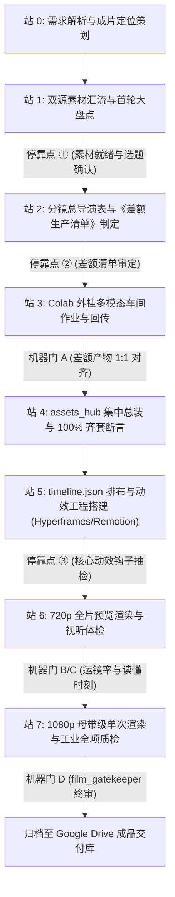

# AG_SOP_04_全源素材重构与外挂多模态视频生产流水线 SOP v1.0
## (Antigravity Cloud Native & Multimodal Edition)

> **版本**：v1.0 | **建立日期**：2026-11-07  
> **产线编号**：P10「全源素材重构 + 外挂多模态车间」 | **表现形态**：形态 11「普适全品类动态重构」 (Universal Media Remix)  
> **总协调大脑**：Antigravity Cloud Agent (策划、分镜编排、全网抓取、代码动效编排)  
> **外挂算力车间**：Google Colab (Colab Pro / 200 CCU 权益池，T4 / A100 GPU)  
> **主力动效引擎**：`HyperFrames` + `Remotion` + `FFmpeg/MoviePy` (Stage25D / React / GSAP / CLI)  
> **AIGC 生产矩阵**：`F5-TTS / CosyVoice` (声音克隆/旁白) + `FLUX.1 / SDXL` (插图/封面) + `CogVideoX / LTX-Video` (动态空镜) + `faster-whisper / SenseVoice` (字级对齐/爆点提取)  
> **资产总装中枢**：Google Drive (统一物理货架：`raw` / `gap_tasks` / `generated` / `assets_hub`)  
> **SOP 沉淀路径**：Google Drive `1YJqjW_FDdyY0iZsFeOSr1x_RK-F1_FFd/AG_SOP_04_全源素材重构与外挂多模态视频/`  
> **成片交付路径**：Google Drive `1FHApfkCr9Xq76E4gTAVR5i3weVsRTmJc/04_全源素材重构/`  
> **核心哲学**：**全源素材汇流，差额按需制造，网盘集中总装，代码全轨动效编排。**

---

## 〇、产线定位与适用边界

### 1. 为什么构建 `AG_SOP_04`？
在此之前，`AG_SOP_01` 锁定了“真素材可视化与证据链”，`AG_SOP_02` 锁定了“快闪字卡”，`AG_SOP_03` 锁定了“原片脱水字幕”。  
但在实际生产中，海量需求属于**“泛品类重构”**：
- 需求来源各异：用户可能丢来几张课件图片、一段随口录音、一份财报 PDF，或者一段 30 分钟未经剪辑的散乱素材；
- 视觉形态普适：成片不拘泥于特定风格，既可以是快节奏卡点解说、科技商业拆解，也可以是叙事性故事片或产品汇报；
- 元素必须丰富：成片需要高质量的原声音色克隆、定制插图、动态空镜、卡点音乐与专业动态字幕。

**`AG_SOP_04` 是全厂第一条“不设限题材”、基于“外挂多模态算力车间”的通用重构旗舰流水线。**

---

## 一、七大顶层设计决策（铁律）

在 Antigravity 云端执行本 SOP，必须严格遵守以下七大不可违背的铁律：

| # | 决策项 | 核心要求与检验标准 |
|:---:|:---|:---|
| **1** | **普适全品类与形态自适应** | 不受限于单一视频模板。根据输入素材的主干特征（语音为主/画面为主/文档为主），自动匹配最契合的视听呈现语法（卡点解说、画中画拆解、视差画轴或高燃快闪）。 |
| **2** | **双源汇流，零盲目开工** | 生产前必须先完成用户 Drive 上传素材与 Antigravity 全网搜集素材的初盘归仓。**严禁在素材尚未明确前空想分镜**。 |
| **3** | **按需造物，差额清单强契约** | 严禁无目标、泛化调用 Colab 盲目生成图片和视频。只有在分镜明确缺少视觉支撑点、原声不可用时，才触发《差额生产清单》（`gap_manifest.json`），精准定义提示词与参数。 |
| **4** | **Google Drive 唯一物理总装货架** | Antigravity 与 Colab 之间禁止无中继的网络盲传。所有素材、差额任务、生成结果、最终成品统一走 Google Drive 对应项目的标准化结构，实现断点续传与持久资产沉淀。 |
| **5** | **算力分级调配与额度纪律** | 充分利用 Google AI Pro 赠送的 200 CCU 与日常免费 GPU。日常批量转写与轻量测试跑 Colab 免费 T4 算力；FLUX 商业高清出图与 CogVideoX 渲染按需开启 A100，精细化管理算力。 |
| **6** | **程序化动效编排重于死板硬切** | 动效编排必须依赖 `HyperFrames`、`Remotion`、`GSAP` 与 `FFmpeg` 多轨道编排完成。平滑运镜（Ken Burns）、画中画弹窗、字级弹跳高亮必须具备视听呼吸感，严禁死板 PPT 式静态拼贴。 |
| **7** | **低清试错，单次母带终审** | 分镜打样、动效验证、音画对齐一律在 720p 无头模式下低成本完成；全片 1080p 母带**全流程只渲染一次**，坚决杜绝无谓消耗云端算力。 |

---

## 二、七站端到端标准化作业全流程

`AG_SOP_04` 将复杂的多模态协作分解为七个标准作业站，实现严密的工序流转与机器自检：



---

### 站 0：需求解析与成片定位策划
* **输入**：用户指令、初始输入文件（文档、音视频、网页链接或简短想法）。
* **执行**：
  * 分析输入素材的核心价值点与叙事逻辑。
  * 确立成片规格：横屏 16:9（B站/YouTube/汇报）或竖屏 9:16（抖音/视频号/Reels）；目标时长（如 60s 金句快剪 / 3min 深度科普）。
  * 确定视觉基调与动效路线（科技冷灰/赛博高燃/极简商务/生活叙事）。
* **产出**：`00_立项/project_brief.json`。

---

### 站 1：双源素材汇流与首轮大盘点
* **执行**：
  * **通道 A（用户自有）**：扫描 Google Drive 用户指定输入目录，自动将图片、录音、PDF、原片拉取至工作区 `01_raw/user_assets/`。
  * **通道 B（全网搜集）**：Antigravity 依据策划要点，调用搜索与直链下载工具，搜集官方高清公报、新闻截屏、行业权威数据表、免版权 B-roll 视频，存入 `01_raw/web_assets/`。
  * **预处理与脱水**：若有长录音或原片，调用 `faster-whisper` 或 `SenseVoice` 提取文字稿与情绪爆点。
* **产出**：`01_raw/material_inventory.json`（原始素材全景清单） $\rightarrow$ **停靠点 ① 确认**。

---

### 站 2：分镜总导演表与《差额生产清单》制定
* **核心原则**：按需生产，查漏补缺。
* **执行**：
  * Antigravity 编写标准 7 列分镜导演表（镜号、起止秒数、台词解说、屏上视觉、视觉来源、运镜动效、音效/BGM）。
  * **差额分析（Gap Analysis）**：对照现有素材库与导演表：
    - 哪些镜头已有真实素材？$\rightarrow$ 标记 `existing`；
    - 哪些镜头需要定制概念图/插画？$\rightarrow$ 提取生图需求；
    - 哪些镜头原声不佳需重新配音？$\rightarrow$ 提取 TTS 配音文案与音色克隆样本；
    - 哪些镜头需要专属动态转场或空镜？$\rightarrow$ 提取文生视频提示词。
  * 结构化生成《差额生产清单》（`gap_manifest.json`）。
* **产出**：`02_导演表/director_board.md` 与 `02_导演表/gap_manifest.json` $\rightarrow$ **停靠点 ② 审定**。

---

### 站 3：Colab 外挂多模态车间作业与回传
* **执行**：
  * 在 Colab 运行 `colab_multimodal_worker.ipynb` 守护进程，挂载同一 Google Drive。
  * Worker 监听并拉取 `gap_manifest.json`，调动 GPU 并行/流水线式执行生产：
    1. **声音克隆与合成（F5-TTS / CosyVoice）**：根据参考音频与文案，生成广播级自然人声 `.wav`，提取字级精确时间戳；
    2. **定制视觉插图（FLUX.1-schnell / SDXL）**：结合统一风格 Token 批量出图（1024×1024 / 16:9 / 9:16），杜绝画风割裂；
    3. **专属动态空镜（CogVideoX-2B / LTX-Video）**：针对关键高潮点生成 3~5 秒流畅动态镜头；
    4. **高清视频封面渲染**：同步出具专属首屏封面。
  * 产出物实时写入 Google Drive `02_generated/` 对应子目录。
* **产出出口**：**机器门 A 拦截（差额产物 1:1 对齐核验）**。

---

### 站 4：`assets_hub` 集中总装与 100% 齐套断言
* **执行**：
  * 将 `01_raw/` 中的可用素材与 `02_generated/` 中的 AIGC 产物汇流至统一的物理货架：`03_assets_hub/`。
  * 遵循严格命名约定：`shot_{NNN}_{source_type}_{description}.{ext}`。
  * 运行 `asset_readiness.py` 进行物理合法性断言：文件大小 $>0$、格式可被 FFmpeg 解析、无坏损。
* **产出**：`03_assets_hub/assets_ready.lock`。

---

### 站 5：`timeline.json` 排布与动效工程搭建 (Hyperframes / Remotion)
* **执行**：
  * 基于真实音频实测毫秒级时间戳，构建绝对时间线 `timeline.json`。
  * **动效编排（Choreography）**：
    - 使用 **HyperFrames**（GSAP / HTML / CSS）编排快闪排版、高燃卡点与赛博 HUD 界面；
    - 或使用 **Remotion**（React 组件体系）编排复杂的多图层视差滚动、画中画（PIP）缩放弹窗、人物跟踪高亮；
    - 针对纯静态图片自动注入 **Ken Burns** 平滑运镜算法（缓慢拉近/摇移 1.05x~1.15x）。
* **产出**：动效工程源码 `src/` 与 `timeline.json` $\rightarrow$ **停靠点 ③ 抽检核心镜头**。

---

### 站 6：720p 全片预览渲染与视听体检
* **执行**：
  * 无头启动 Playwright / Remotion CLI 进行 720p 快速分镜渲染。
  * 运行 `motion_check.py` 检验整片运动活跃度（有效运镜帧 $\ge 25\%$）。
  * 自动抽取每镜关键帧（Keyframe Strip），进行视觉易读性审查（文字对比度、停留时长 $\ge 1.2s$）。
* **产出**：`out/preview_720p.mp4` 与抽检长图 $\rightarrow$ **停靠点 ④ 确认**。

---

### 站 7：1080p 母带级单次渲染与工业全项质检
* **执行**：
  * 执行正式 1080p 高清无头渲染。
  * 启动 `audio_bgm_mixer`：
    - 加载正式人声与精选 BGM；
    - 执行 Sidechain 智能避让（人声段 BGM 自动压低 -12dB 至 -15dB）；
    - 统一整片响度标准化为 `-16.0 LUFS (±1.5)`。
  * FFmpeg 音画高保真封装（H.264 High Profile, AAC 192kbps）。
  * 运行 `film_gatekeeper` 全项机器拦截。
* **产出**：`out/final_master_1080p.mp4`，并自动归档至 Google Drive 成品库。

---

## 三、五大停靠点机制与四道机器门禁

### 1. 停靠点分级矩阵 (Stop Points)

| 停靠点 | 所属工序 | 级别 | 核心验收判据 | 失败处置动作 |
|:---:|:---:|:---:|:---|:---|
| **①** | 站 1 素材大盘点 | **🔴 必留** | 双源素材分类登记完整、长音频/原片已完成转写脱水 | 补足基础素材，不得开启分镜编写 |
| **②** | 站 2 差额清单审定 | **🔴 必留** | 导演表 7 列自洽、《差额清单》Prompt 及参数无模棱两可项 | 回退修改清单，严禁启动 Colab 盲目算力 |
| **③** | 站 5 核心镜头试制 | **🟡 可选** | 开头 5~8 秒黄金钩子（Hook）及核心动效组件抽检满意 | 微调动画参数，满意后方可铺满全片 |
| **④** | 站 6 720p 预审定稿 | **🔴 必留** | 720p 粗剪音画同步、运动节奏舒适、关键信息无遮挡 | 在代码层微调时间戳，严禁直奔 1080p |
| **⑤** | 站 7 最终交付审定 | **🔴 必留** | `film_gatekeeper` 全绿通过、成片及配套物料完整 | 针对门禁报错补丁微调 |

### 2. 四道机器门禁断言 (Machine Gates)

```text
[门禁 A: gap_completion_gate] ──> 校验 Colab 回传文件与 gap_manifest.json 100% 吻合 (exit 0)
[门禁 B: asset_readiness_gate] ─> assets_hub 货架内素材物理存在、编码合规、无 0 字节文件
[门禁 C: motion_dynamic_check] ─> 全片镜头平滑运动活跃度 >= 25% (杜绝死板幻灯片)
[门禁 D: film_gatekeeper] ─────> 1080p, 30fps, 音画时长差 <= 0.35s, -16±1.5 LUFS, 零黑场
```

---

## 四、技术踩坑速查与云端避坑指南 (Tech Pitfalls)

| 编号 | 典型故障现象 | 根本诱因 | `AG_SOP_04` 专属规避策略 |
|:---:|:---|:---|:---|
| **D-401** | Colab 免费实例因空闲超时断连 | 连续长时间任务缺乏交互信号 | **批处理断点持久化**。Colab Worker 每完成一项生成立即写入 Google Drive 并更新 `status.json`，即便断开重连也能秒级续跑。 |
| **D-402** | Colab 加载大型模型爆显存 (OOM) | 默认 FP16 精度占用显存超出 16GB | **强制量化与切片装载**。FLUX.1 采用 NF4/GGUF-Q5 量化（仅占 10G 显存）；CogVideoX 开启 Diffusers 的 `enable_model_cpu_offload()` 内存切片。 |
| **D-403** | 生成的插图画面画风混乱、割裂 | 每张分镜使用的 Prompt 风格描述词各异 | **统一风格注入 Token（Style Preset）**。在 `gap_manifest.json` 中统一注入母风格词（如：`cinematic lighting, minimalist tech blueprint, high contrast, 8k`）。 |
| **D-404** | F5-TTS 克隆出的旁白有杂音或机械感 | 参考音频包含背景噪音或说话人含糊 | **参考音频清洗预处理**。只选取 5~8 秒咬字清晰、无混响、无 BGM 的纯净干声切片作为音色种子。 |
| **D-405** | 全网搜集素材画质过低导致成片变糊 | 抓取的网络图片/截屏分辨率不足 720p | **2.5D 降级与画中画包装**。低清素材禁止强行拉伸全屏，统一置于 2.5D 舞台背景层并适度模糊，或加精致边框做画中画浮窗展示。 |
| **D-406** | 动效过载导致喧宾夺主 | 滥用酷炫旋转和弹跳动效，冲淡核心信息 | **“一镜一认知”克制原则**。动效服务于视线引导（Highlight / Zoom In），非必要不加纯装饰性动画。 |

---

## 五、Google Drive 统一中枢目录契约与交付规范

在 Google Drive 中，每个 `AG_SOP_04` 生产项目均严格遵循如下标准化树状目录树：

### 1. 生产工程工作区结构 (`Drive/AIStudio/projects/{PROJECT_ID}/`)
```text
{PROJECT_ID}/
├── 00_立项与策划/
│   ├── project_brief.json             # 选题、规格、风格基调
│   └── 原始需求.md
├── 01_raw_assets/                     # 双源原始素材库
│   ├── user_assets/                   # 用户上传素材 (录音/课件/视频)
│   └── web_assets/                    # Antigravity 全网嗅探下载素材
├── 02_generated/                      # Colab 外挂车间产出物
│   ├── voices/                        # F5-TTS 生成的旁白分段 wav
│   ├── images/                        # FLUX 生成的定制插图
│   └── video_clips/                   # CogVideoX 生成的动态空镜
├── 03_assets_hub/                     # 集中总装货架 (100% 齐套规范命名)
│   ├── shot_001_raw_intro.mp4
│   ├── shot_002_gen_flux_chip.png
│   ├── shot_003_voice_cloned.wav
│   └── bgm_cinematic.mp3
└── 04_编排工程/
    ├── director_board.md              # 7 列导演表
    ├── gap_manifest.json              # 差额生产清单
    ├── timeline.json                  # 绝对时间轴排布
    └── src/                           # Hyperframes / Remotion 源码工程
```

### 2. 最终成品交付结构 (`Drive/1FHApfkCr9Xq76E4gTAVR5i3weVsRTmJc/04_全源素材重构/{YYYYMMDD}_{标题}_v1/`)
```text
{YYYYMMDD}_{标题}_v1/
├── 交付成片/
│   ├── final_master_1080p.mp4         # 终审 1080p 高保真成片 (-16 LUFS)
│   ├── preview_720p.mp4               # 720p 快速分发展示版
│   └── 官方封面_16x9.jpg              # 精选视频封面
├── 质检门禁报告/
│   ├── gatekeeper_report.json         # film_gatekeeper 终审合格单
│   ├── motion_check_report.json       # 镜头活跃度断言报告
│   └── keyframe_strip.png             # 关键帧全局抽检长图
└── 归档导演表/
    └── 完整分镜与生产明细.md
```

---

## 六、结语与执行规约

`AG_SOP_04` 代表着云端视频生产从**“手工作坊”**向**“分布式现代电影制片厂”**的质的跨越：
- **Antigravity 是总制片人、编剧兼剪辑总监**；
- **Colab 是顶级数字特效与声效录音棚**；
- **Google Drive 是穿透所有环节的现代化资产中转保税仓**。

全厂智能体与执行器自发布之日起，严格遵循本 SOP 的七大铁律与七站流程执行，确保出片必达工业级标准！
